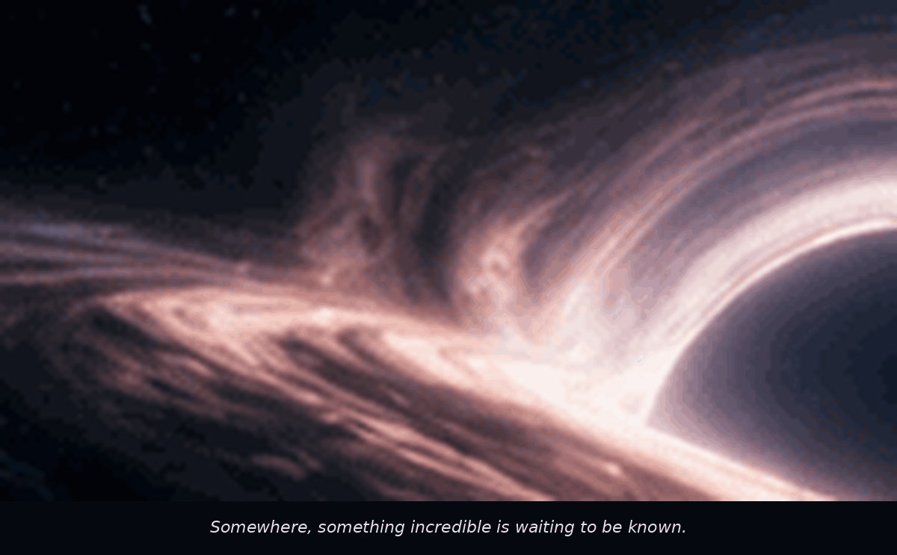

<div align="center">



<br/>

*Somewhere, something incredible is waiting to be known.*

<br/>

<sub>✦ &nbsp;· &nbsp;˚ &nbsp;✧ &nbsp;· &nbsp;&nbsp;&nbsp;&nbsp;⋆ &nbsp;· &nbsp;✦ &nbsp;· &nbsp;˚ &nbsp;⋆ &nbsp;·&nbsp; ✧ &nbsp;· &nbsp;&nbsp;&nbsp;✦ &nbsp;· &nbsp;˚ &nbsp;⋆</sub>

# `M I L L E R`

### `17 // IN PROGRESS...`

**`SYSTEMS ENGINEERING · DEVELOPER · CREATOR`**

<sub>◦ ─────────── ◈ ─────────── ◦</sub>

*"Convirtiendo ideas en tecnología, mientras aprendo, desarrollo y evoluciono."*

<br/>


<br/>


</div>

<br/>

<div align="center">

## ◈ &nbsp;`01 // ABOUT ME`&nbsp; ◈

<sub>`MISSION BRIEFING`</sub>

</div>

<table align="center">
<tr>
<td width="62%" valign="top">

**Quién soy**

Estudiante de Ingeniería de Sistemas explorando el desarrollo de software, la programación, la automatización y la inteligencia artificial.

Me gusta aprender creando, experimentar con nuevas ideas y convertir problemas en soluciones tecnológicas.

> *Learning by building.*

</td>
<td width="38%" valign="top">

**Telemetría**

```text
 CALLSIGN   MILLER
 AGE        17
 CLASS      SYSTEMS ENG.
 ROLE       DEV · CREATOR
 CORE       J.A.R.V.I.S.
 STATUS     IN PROGRESS
```

</td>
</tr>
</table>

<br/>

<div align="center">

## ◈ &nbsp;`02 // TECH STACK`&nbsp; ◈

<sub>`ONBOARD INSTRUMENTS`</sub>

<br/>


<br/>


</div>

<br/>

<div align="center">

## ◈ &nbsp;`03 // MAIN PROJECT`&nbsp; ◈

<sub>`THE CORE OF THE MISSION`</sub>

<br/>

<sub>⋆ &nbsp;˚ &nbsp;✧ &nbsp;· &nbsp;&nbsp;&nbsp;&nbsp;·&nbsp;&nbsp;&nbsp; ✦ &nbsp;· &nbsp;˚ &nbsp;⋆ &nbsp;·&nbsp; ✧ &nbsp;˚</sub>

<br/>


<br/>

# `J.A.R.V.I.S.`

**`JUST A RATHER VERY INTELLIGENT SYSTEM`**

<br/>


<br/>

<sub>◦ ─────────── ◈ ─────────── ◦</sub>

</div>

<br/>

Mi proyecto principal: un asistente inteligente personal que construyo de forma progresiva. Explora inteligencia artificial, automatización e interacción con el computador, integrando distintas funcionalidades en un solo sistema.

<table align="center">
<tr>
<td width="50%" valign="top">

**Objetivos actuales**

- [x] Crear la base del proyecto
- [x] Configurar el entorno de desarrollo
- [x] Integrar Python
- [ ] Implementar funcionalidades inteligentes
- [ ] Incorporar automatización
- [ ] Explorar interacción por voz
- [ ] Expandir sus capacidades

</td>
<td width="50%" valign="top">

**Estado del núcleo**

```text
 CORE ........ ONLINE
 AI .......... ▰▰▱▱▱▱▱▱  EARLY
 AUTOMATION .. ▰▱▱▱▱▱▱▱  PLANNED
 VOICE ....... ▱▱▱▱▱▱▱▱  EXPLORING
 PHASE ....... IN DEVELOPMENT
```

</td>
</tr>
</table>

<div align="center">

> *JARVIS is not finished. Neither am I.*

<br/>


</div>

<br/>

<div align="center">

## ◈ &nbsp;`04 // OTHER PROJECTS`&nbsp; ◈

<sub>`ORBITING THE CORE`</sub>

</div>

<table align="center">
<tr>
<td width="50%" valign="top">

**◉ JARVIS**

Personal AI assistant


</td>
<td width="50%" valign="top">

**◉ TaveraTranslator**

Desktop translation application


</td>
</tr>
<tr>
<td width="50%" valign="top">

**◉ FinanceERP**

Financial management system concept


</td>
<td width="50%" valign="top">

**◉ Python Lab**

Programming exercises & experiments


</td>
</tr>
</table>

<div align="center">

<br/>


</div>

<br/>

<div align="center">

## ◈ &nbsp;`05 // CURRENT MISSIONS`&nbsp; ◈

<sub>`FLIGHT PLAN`</sub>

</div>

<table align="center">
<tr>
<td width="50%" valign="top">

**Completed**

- [x] Start my Systems Engineering journey
- [x] Learn Python fundamentals
- [x] Create my first projects
- [x] Improve programming logic

</td>
<td width="50%" valign="top">

**In flight**

- [ ] Explore Artificial Intelligence
- [ ] Develop automation solutions
- [ ] Build more complex projects
- [ ] Keep exploring the unknown

</td>
</tr>
</table>

<div align="center">

```text
 MISSION PROGRESS   ▰▰▰▰▱▱▱▱   4 / 8 OBJECTIVES
```


</div>

<br/>

<div align="center">

## ◈ &nbsp;`06 // GITHUB ACTIVITY`&nbsp; ◈

<sub>`FLIGHT DATA`</sub>

<br/>


<br/>


</div>

<br/>

<div align="center">

## ◈ &nbsp;`07 // SYSTEM LOG`&nbsp; ◈

<sub>`TRANSMISSION`</sub>

</div>

```text
┌──────────────────────────────────────────────┐
│  > Initializing MILLER...                    │
│  > Loading curiosity ............... OK       │
│  > Loading creativity .............. OK       │
│  > Loading determination ........... OK       │
│                                              │
│  > Exploring new technologies                │
│  > Building projects                         │
│  > Debugging and evolving                    │
│                                              │
│  [ SYSTEM STATUS: ALWAYS LEARNING ]          │
└──────────────────────────────────────────────┘
```

<br/>

<div align="center">

<sub>✦ &nbsp;· &nbsp;˚ &nbsp;✧ &nbsp;· &nbsp;&nbsp;&nbsp;&nbsp;⋆ &nbsp;· &nbsp;✦ &nbsp;· &nbsp;˚ &nbsp;⋆ &nbsp;·&nbsp; ✧ &nbsp;· &nbsp;&nbsp;&nbsp;✦ &nbsp;· &nbsp;˚ &nbsp;⋆</sub>

### `EXPLORING THE UNKNOWN.`

<sub>`MILLER // DEVELOPMENT HUB`</sub>

<br/>


</div>

